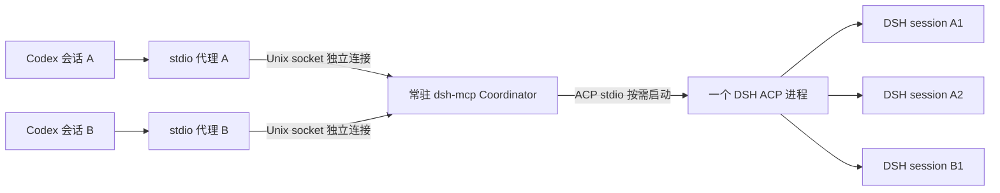

# DSH ACP 多客户端与历史会话恢复方案

日期：2026-10-19。状态：两期源码已实现并在隔离环境验证，部署候选已准备；按用户要求保留现有生产入口。验证层次与限制见 [验证记录](../../validation.md)。

## 1. 目标与实施顺序

确定的目标架构是：同一 Linux 账户下，所有 Codex 会话共用一个常驻 `dsh-mcp` 服务，由该服务拥有一个按需启动的 DSH ACP 进程，管理多个独立 DSH session。每个 DSH session 对应独立模型上下文；同一 session 的多轮任务沿用上下文，不同 session 可以并行执行。每个 Codex 仅启动轻量连接代理，不再各自启动 Coordinator 或 ACP。

需要满足：每个 Codex 可派发多个独立子任务；返工继续原 DSH 上下文；Codex 断线后可以找回任务；桥接重启后可以显式恢复已持久化的非活跃 DSH 会话。这里的“独立上下文”指独立会话历史，不表示固定预分配若干 token 窗口或自动复制 Codex 主会话的全部上下文。

实现拆成两个增量，逐项验收；两个增量都完成才达到本次共享服务目标：

1. **一期：历史会话列举和恢复。** 保留现有独立 stdio 实例，增加 `list_sessions`、`resume_task`，先解决上下文不能找回的问题。
2. **二期：共享守护进程。** 一个常驻协调进程拥有一个按需启动的 ACP；各 Codex 只启动轻量 stdio 代理，通过 Unix socket 连接。增加任务发现与显式接管。

一期可单独验证，但不是本次目标的最终部署形态；二期依赖一期通过验收。正式目标是共享 daemon，不把“每个 Codex 一个 ACP”作为并列可选方案。实施计划分别位于相邻 `plans` 目录，原独立 stdio 模式仅为兼容和回退保留。

## 2. 实施前已确认的基线

以下为实施前的配置、源码和安装包基线；新增历史恢复、共享传输及 11 工具已在本次实现，当前生产配置仍沿用旧入口。

| 项目 | 已确认内容 |
|---|---|
| 源码 | `/home/workspace/dsh-mcp`，存在大量已有未提交修改及未跟踪源码，必须保留 |
| 桥接 | Rust，包版本 `0.1.0`，rmcp `3.5.1`、agent-client-protocol `3.4.0` |
| 当前 DSH | `0.2.1-rc.2`；仓库旧 README 中的版本更早，不能照抄为当前安装版本 |
| 传输 | `src/main.rs` 只提供 MCP stdio；一个 MCP 生命周期拥有一个 Coordinator |
| ACP | 首次任务时才启动；单 ACP 可承载多个独立 session，同一 session 一轮一轮执行 |
| 现有工具 | `start_task`、`get_task`、`send_followup`、`cancel_task`、`resolve_permission`、`close_session` |
| 容量 | 每实例默认活动任务 `4`、未关闭会话 `16`、闲置 TTL `1800` 秒 |
| 历史 | DSH 支持 `session/list`、`session/resume`、`session/close`；桥接仅记录 list/resume 能力，未提供调用接口 |
| 数据 | 桥接任务、request_id、事件、映射在内存；DSH 自己持久化模型会话 |
| 握手修复 | Python launcher 为每个实例创建独立状态目录，避免独占锁冲突；不能退回多个进程抢同一个目录 |

主要源码入口：`src/main.rs`、`src/acp.rs`、`src/coordinator.rs`、`src/server.rs`、`src/task.rs`、`src/runtime_guard.rs`。DSH 的依据文件为 `/home/agent_coding/.npm/_npx/50d2c97abf8f4186/node_modules/@deepseek-ai/dsh-acp/README.zh.md`。

当前生产入口和配置：

- `/home/agent_coding/.codex/tools/dsh-acp/launch.py`
- `/home/agent_coding/.codex/config.toml` 中的 `mcp_servers.dsh_acp`
- `/home/agent_coding/.dsh/profiles/acp/cordis.patch.yml`：`provider=deepseek-official`、`model=deepseek-v4-flash`
- `DSH_HOME=/home/agent_coding/.dsh`

模型仍由 DSH ACP profile 管理。Web 的访问 token 与 ACP 接入无关。当前对话没有加载原生 `dsh_acp` 工具；此前 MCP 测试由真实 stdio 客户端完成，新会话需重新确认工具可见性。

## 3. 架构选择

| 方案 | 收益 | 代价与限制 |
|---|---|---|
| 独立实例 + 恢复接口（一期中间步骤） | 改动集中；沿用已验证的接入方式验证恢复 | 每个使用中的 Codex 仍有自己的 ACP；不能作为共享服务目标的最终验收结果 |
| **Unix socket 共享守护进程 + stdio 代理（确定的目标）** | 统一任务、权限与额度；Codex 断线不关闭任务；无需新增 TCP 监听 | 需新增连接生命周期、接管规则和守护进程部署 |
| Streamable HTTP 共享 MCP | 适合未来跨机器直连 | 当前仓库未实现，需要新增 HTTP 传输和相应鉴权、配置；本机需求暂不需要 |



每个 socket 连接独立执行 MCP initialize 和请求处理。代理只转发字节；不要发明另一套内部 RPC，也不要把多个 Codex 的 MCP 字节混到一条连接。

共享进程减少重复进程和统一管理的成本；每个 session 仍有独立模型上下文，不承诺减少模型 token。ACP 故障仍可能影响其全部 session。

## 4. 一期接口与行为

保留原六工具的参数与行为，新增：

```text
list_sessions(cwd?: string, cursor?: string)
  -> {sessions: [{dsh_session_id, cwd, title?, updated_at?}], next_cursor?}

resume_task(request_id: string, dsh_session_id: string, cwd: string, prompt: string)
  -> {task_id, session_id, status, deduplicated}
```

- `list_sessions` 透传 ACP 的不透明分页 cursor；不自行截掉结果后返回后端下一页 cursor。标题等展示文本可以有界裁剪，标识和 cwd 不可裁剪；页面超出响应预算时返回明确错误。
- 列举可懒启动 ACP，但不创建任务或占用 session。启动与列举在 actor 外异步等待，不能卡住 `get_task`、取消或权限裁决。
- 后端不支持对应能力时返回 `capability_unsupported`，不得悄悄创建新会话或读取 DSH 内部日志充当恢复。
- `resume_task` 是“显式恢复 + 提交新一轮”的原子准入入口，沿用 `start_task` 的绝对存在目录校验、额度、异步接单与去重规则。其去重指纹包含工具名、原始 cwd、DSH session ID、prompt。
- 接单后先预留任务与 session，再调用 ACP resume；安装事件路由后才能发送 prompt。第一轮新建桥接 `session_id`、`task_id`，`parent_task_id=null`，TaskView 新增 `resumed_from_dsh_session_id`。后续正常使用最新 task ID 调用 `send_followup`。
- ACP resume 不回放旧更新。本期不恢复旧桥接 task ID、旧事件 cursor 或 request_id；旧 `get_task` 仍可能返回 `task_not_found`。
- 本实例仍持有未关闭的目标 DSH session 时，恢复返回 `session_busy`；当前活跃会话继续使用 `send_followup`，二期可以显式接管。
- resume 失败不能降级成 new_session；超时/断连沿用现有隔离与恢复保护，不能在结果不明时继续提交 prompt。

**活动状态的证据边界：** 安装文档要求恢复非活跃会话，但尚未证明 DSH 能在不同进程间完整检测会话占用。一期只验收已确认关闭的历史会话；不支持多个独立 ACP 同时恢复同一个历史 session，也不接管 Web 中仍活跃的 session。列举记录不等于已证明它当前可安全恢复。二期通过统一 Coordinator 解决它所管理会话的并发接管，仍不承诺控制外部 Web 活跃会话。

## 5. 二期运行方式与连接归属

二进制提供三个入口：

```text
dsh-mcp             # 保留原来的独立 stdio 模式
dsh-mcp --daemon    # 一个 Coordinator，接受多个 Unix socket MCP 连接
dsh-mcp --proxy     # 本地 stdio <-> Unix socket 转发，不拥有 Coordinator/ACP/运行锁
```

保留 `--help`、`--acknowledge-cleanup`，禁止混用模式参数。

配置决定：

| 配置 | 推荐值/行为 |
|---|---|
| `DSH_MCP_SOCKET` | 绝对路径，部署为 `$XDG_RUNTIME_DIR/dsh-mcp/acp.sock`；无可用 runtime dir 时显式配置私有目录，不用公共 `/tmp` socket |
| daemon `DSH_MCP_STATE_DIR` | `/home/agent_coding/.local/state/dsh_acp/shared`，稳定目录，仅 daemon 持有独占锁 |
| 全局容量 | 沿用活动任务 `4`、未关闭会话 `16`、TTL `1800` 秒；从每实例变为整个 daemon 的总额 |
| 连接上限 | `DSH_MCP_MAX_CLIENTS=32`；未完成 initialize 的连接计入上限，握手超时 `10` 秒 |
| 排队 | 不新增；满额仍立即返回 `capacity_exceeded` |

历史列举全局最多 32 个在途请求，控制调用有超时；客户端取消等待后，直到后台调用完成才释放额度。

共享连接必须在 JSON 解析前限制每条 MCP 帧至 `1 MiB`，每连接最多 `16` 个未完成请求和 `16` 个待发送响应，单次写入期限 `10` 秒；响应沿用现有 `320 KiB` 编码预算。超限/写超时仅结束对应连接并释放归属，不取消已接纳任务。连接数限制不能代替帧、请求、响应积压限制；代理本身使用固定大小字节缓冲。

socket 父目录 `0700`、socket `0600`，校验 Linux peer UID 与运行账户一致。单账户是共同信任范围；任务归属用于防误操作，不是隔离同 UID 恶意进程的安全边界。不得无条件 unlink 已有 socket 或使用中的运行锁。

每个连接由 daemon 分配随机 `ClientId`，不依赖未经验证的 Codex 环境变量。session 有零个或一个当前 owner；同一 owner 可拥有多个 session。原六工具保留参数，owner 检查由连接上下文隐式提供。

新增：

```text
list_tasks(cwd?: string, scope?: "mine"|"unowned"|"all", cursor?: string, limit?: integer)
  -> {tasks: [{task_id, session_id, status, cwd, latest_task_id,
               owner_state: "mine"|"other"|"unowned", followup_available}], next_cursor?}
  # scope 默认 mine；limit 默认 50，最大 100；返回本 daemon 尚保留的任务

attach_session(session_id: string)
  -> {session_id, latest_task_id, session_state, owner_state: "mine"}
```

- `get_task` 和 `list_tasks(scope=all)` 可读同 UID 范围的记录；写操作仅当前 owner 可执行。`start_task`、`resume_task` 创建的 session 属于调用连接。
- `send_followup`、取消、权限裁决、关闭的归属检查必须在 Coordinator 内执行，不能只放 MCP handler。
- owner 断连后，session 原子变为 unowned，已接单任务继续执行；不关停 ACP，不取消其他任务。未接纳的旧连接迟到写请求必须被拒绝。
- `attach_session` 只认领 unowned session，或幂等返回已属于自己的 session；其他活连接持有时返回 `session_owned`，不提供强制抢占参数。允许接管仍在运行或等待权限的任务，返回最新 task ID。
- closed/lost session 不可通过 attach 恢复执行。正常 closed 的历史可显式 `resume_task`；lost 若由后端隔离导致，必须先完成下述故障恢复流程，不能在 unavailable 后端直接 resume。接管不新建模型轮次，也不自动放行待决权限。
- owner 断连期间的权限仍按原 `600` 秒超时处理；接管后可处理尚有效的原请求。只接受请求公布的原始 `option_id`。
- 查询与接管不重置闲置 TTL。session 的业务状态、owner 与轮次终态相互独立。
- 任务记录默认上限 `256`，可回收终态记录的默认保留期 `86400` 秒；活动任务和未关闭会话的最新任务不淘汰。容量压力可提前淘汰符合条件的终态记录，淘汰同时删除 request_id 去重记录。保留期通过 `DSH_MCP_TASK_RETENTION_SECS` 配置，不改动默认值；会话闲置 `1800` 秒关闭与记录保留互不等同。
- request_id 仅在对应任务记录尚保留时于 daemon 内全局去重。同 ID 同参数只返回原任务，不重新执行，也不隐式夺取 owner；新连接需要显式 attach。跨 daemon 重启不保证去重，不能自动重发未知结果的写请求。
- 并行实现仍需不同文件所有权或独立工作区；共享 Coordinator 不提供文件修改隔离。

## 6. 重连、重启与清理

| 情形 | 明确行为 |
|---|---|
| Codex 退出或代理 EOF | 只关闭该连接；任务继续，session 可被新连接发现和接管 |
| 代理与 daemon 连接中断 | 代理 stderr 给出有界错误并退出；不透明自动重连可能丢失请求结果，故本期不实现 |
| daemon 正常停止 | 执行现有有界取消、关闭、ACP 回收与标记清理；全部连接结束 |
| daemon 存活但后端隔离 | MCP 握手/查询仍可用，执行拒绝；无自动替换 ACP 或重放。按下面流程人工恢复 |
| daemon 崩溃、异常清理 | 稳定状态目录保留恢复标记；新 daemon 拒绝新执行，人工核对并确认后才重新准入 |
| daemon 重启后 | 内存 task ID 和请求记录不恢复；通过 DSH list/resume 恢复历史上下文，生成新的桥接 task ID |

故障恢复步骤：先通过任务快照或只读 `get_status` 确认 backend/recovery 状态，停止接纳新执行；保留原任务证据，正常停止 daemon 并核对 ACP 与执行后代均已清理；只有确认清理后，才在同一稳定状态目录执行 `--acknowledge-cleanup`；重启 daemon，确认执行准入恢复，再 list/resume 非活跃历史，生成新桥接 task ID。`initialize`/`ping` 成功不能作为执行健康的证据。`get_status` 返回 backend/state、recovery_required、draining、活动任务与未关闭会话数量，不启动 ACP，也不刷新 TTL。

会话关闭失败或控制请求超时也可能触发整个 ACP 的隔离，影响其他客户端的 session。必须验收 A 会话关闭失败时 B 的停止证据、lost 状态、全局执行拒绝以及保留的恢复标记。

不能把 DSH 主进程 PID 消失当作所有执行后代已停止的证据；不能自动清除 recovery marker、按进程名批量杀进程或自动重放 prompt。暂不增加持久化任务数据库、跨重启事件回放、自动重连或 ACP 进程池。

## 7. 开发、部署与回退

1. 新会话先保存当前 diff/未跟踪文件清单，建立包含**当前完整工作树**的隔离副本或工作区。普通 `git worktree add HEAD` 不会带入当前未提交的桥接实现，不能直接把它当作完整基线。
2. 本次用户明确要求全部由 Codex 主代理直接实现、测试与审查，不委派 DeepSeek 或其他子代理。保留现有生产入口，本次仅交付源码、隔离验证及部署候选；未获生产切换指令前不更改正在运行的服务或 Codex 配置。
3. bridge 自身通过 DSH 修改时，运行中的工具仍用旧已部署二进制；新构建在隔离位置验证。不要在任务仍依赖旧桥接时替换或停止它。
4. 一期验证完成后保留原 launcher；二期先运行临时 daemon 与两个真实 stdio 客户端验证，之后才准备正式 user systemd unit 与候选 Codex 配置。
5. 正式部署使用版本化二进制路径，模型认证环境仅从现有私有配置/受保护环境注入，不把凭据写入仓库、报告或命令输出。systemd 不继承交互 shell 的全部环境，必须核验所需环境实际可用。
6. 二期 Codex 配置仍使用 command/args，改为版本化二进制 `--proxy`，代理只需 socket 配置；DSH 启动参数、profile 和稳定状态目录移到 daemon 环境。
7. systemd 使用用户服务，`TimeoutStopSec=70s`，保留桥接原 `50s` 关停预算；恢复保护不能被重启策略绕过。不更改现有 `dsh-web.service`。
8. 切换前备份当前配置与 launcher，记录部署文件和验证证据。回退恢复原独立 launcher；先处理共享 daemon 的未结束任务，不能无提示遗留任务或把它们自动迁移到独立实例。

配置落盘、服务管理等超出可写目录的动作按运行环境实际权限申请执行。当前方案文档不代表已经完成部署。

## 8. 验收与不做项

开发交付已通过确定性后端与真实 MCP 传输验证。2026-10-20 用户后续要求真实验收，已追加通过实际 Codex 原生接入、真实模型文件写入、同会话回忆与跨 ACP 进程恢复回忆；仅使用临时文件和随机代号，Codex 独立核验结果。生产切换未执行，真实模型权限请求未触发，后者仍不作为已覆盖项。

一期：历史分页、能力缺失、恢复去重、恢复失败不建新会话、同 session 追加、关闭后跨 ACP 进程恢复并记住代号、旧 task ID 不伪装恢复。

二期：两个真实 MCP 客户端同时握手；合计四任务并发且第五个拒绝；同 session 并发追加拒绝；客户端 A 断开而 B 不受影响；新连接显式接管 A；待决权限不串线；重启与运行锁、异常恢复标记保持正确；旧独立 stdio 回归通过。

暂不做远程 HTTP、Web 活跃会话控制、会话 fork、任务队列、每客户端公平配额、自动 worktree、ACP 进程池、自动重放、跨重启桥接任务数据库。需要这些能力时再单独设计。
